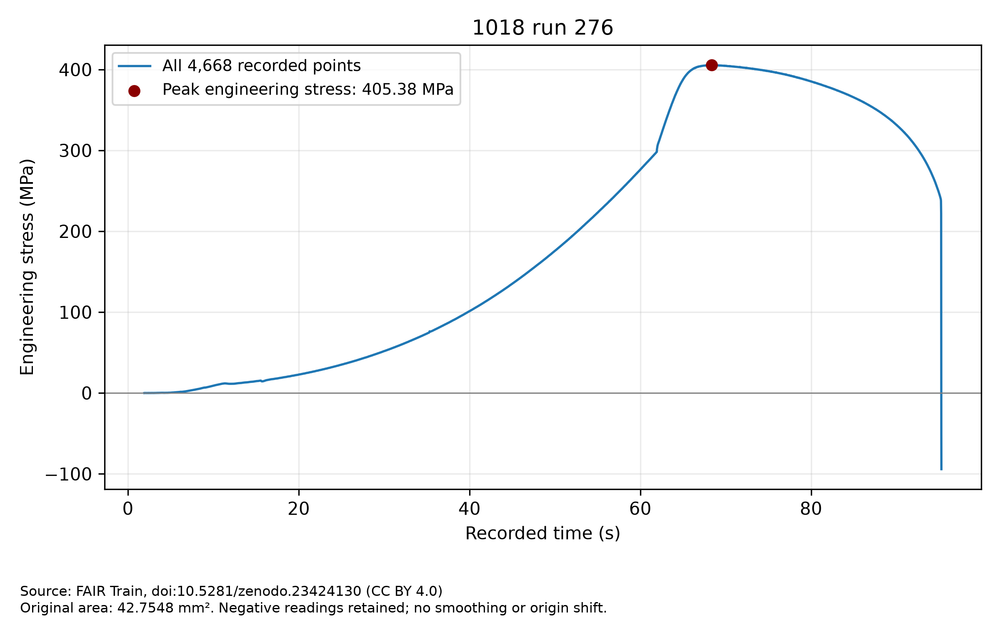

# Tensile Data Quality Review

A student portfolio project on reproducible processing and quality assessment
of experimental tensile-test data using Python.

[](https://github.com/Devanjan10/tensile-data-quality-review/actions/workflows/review.yml)

## Current result

The selected workbook contains **4,668 measurement rows**. Original dimensions
of 13.53 × 3.16 mm give an area of **42.7548 mm²**. Calculated peak engineering
stress is **405.3774 MPa** at source record Index 3322, consistent with the
source-reported 405.4 MPa within a 0.05 MPa absolute rounding tolerance.

The review passes with warnings: 57 negative load readings and 23 negative
extensometer readings are retained for contextual review. Arithmetic agreement
does not establish experimental accuracy or standards compliance.



Read the [generated review](outputs/1018_run_276_review.md),
[machine-readable report](outputs/1018_run_276_review.json), and
[methods and limitations](docs/ANALYSIS_NOTES.md).

A second experimental specimen, **4130 steel, run 280**, also passes with
review warnings. Its 7,438 rows and 43.2 mm² original area give a peak of
**486.1632 MPa**, consistent with the source-reported 486.2 MPa. See its
[review report](outputs/4130_run_280_review.md). All negative readings are retained.

## Run locally

Tested with Python 3.12. From the repository root on Ubuntu:

```bash
python3 -m venv .venv
source .venv/bin/activate
python -m pip install -r requirements.txt
python -m unittest discover -v
python -m scripts.review
python -m scripts.review data/raw/4130_run_280.xlsx
```

Each review command validates its workbook, reconciles area and peak stress,
exports the derived CSV, checks exact CSV reloading, generates PNG/PDF figures,
and writes Markdown/JSON reports. It does not modify the input workbook.

The 32-test suite includes known numerical answers, validation regressions,
labeled synthetic error-injected fixtures, failure-report checks and an
integration tests against both bundled experimental workbooks. Tests write their
artifacts in temporary directories. GitHub Actions is configured to run the
tests, verify the checksum, regenerate the review and upload its artifacts.

To verify the raw input manually:

```bash
(cd data/raw && sha256sum -c SHA256SUMS)
```

To inspect the workbook or measurements separately:

```bash
python -m scripts.inspect_workbook
python -m scripts.read_measurements
```

The earlier `python scripts/check_geometry.py` entry point now runs the complete
review. `python scripts/plot_stress_time.py` replots the bundled CSV only after
checking its stress against original geometry and its measurements against the
source workbook.

## Outputs and status

For the default specimen, `outputs/` contains:

- `1018_run_276_engineering_stress.csv`: all original measurement columns plus engineering stress.
- `1018_run_276_stress_time.png` and `.pdf`: engineering stress versus recorded time.
- `1018_run_276_review.md` and `.json`: checksum, software versions, row count,
  units, geometry, peak comparison, check outcomes, review warnings, artifact
  checksums and limitations.

The second specimen produces the same five output types with prefix
`4130_run_280`.

`pass` and `pass_with_warnings` exit with code 0; `fail` exits with code 1.
Warnings require interpretation and do not imply that the experiment is valid.
Failed reviews write reports and do not export new derived data or figures.
Artifacts from an earlier run may remain in the output directory; the latest
report's `artifacts` list identifies the files produced by that run. Use a fresh
output directory when comparing runs.

## Reviewing another workbook

```bash
python -m scripts.review /path/to/specimen.xlsx --output-dir outputs/another-specimen
```

Supported layout: one metadata row in `Sheet1` (headers on Excel row 1),
measurements in `Sheet2` (headers on Excel row 2), and rectangular original
geometry. Required metadata fields are `Width (mm)`, `Thickness (mm)`,
`Area (mm²)` and `Maximum Stress (N/mm²)`. Measurement fields are `Index`,
`Load (N)`, `Crosshead (mm)`, `Extensometer (mm)` and `Time (sec)`.

The selected workbook's absolute tolerances are 0.00005 mm² for area and
0.05 MPa for peak stress. Review the displayed precision before applying this
workflow to other workbooks. Units are inferred from required column labels;
physical units are not independently verified. Other inputs receive a recorded
SHA-256 and an unverified-input warning unless their bytes match the bundled
reference checksums. Source attribution is applied only to known inputs.
The output directory must be separate from the input and raw-data directories.

Both bundled specimens have been verified using the same implementation.
This demonstrates two compatible inputs, not compatibility with all tensile
workbook formats or experimental standards.

## Input and method

`data/raw/1018_run_276.xlsx` and `data/raw/4130_run_280.xlsx` are unchanged
workbooks from FAIR Train: tensile testing data, Zenodo record 23424130.
Only their filenames were shortened. The original archive contains 11 raw
workbooks; this repository includes two.

See [source attribution](docs/DATA_SOURCE.md) for the DOI, author credits,
reuse terms, original archive path and checksums. Source-reported properties
are reference values, not results calculated by this project.

Engineering stress is force in N divided by original area in mm², giving MPa.
Negative measurements are preserved without smoothing, origin shifts or
outlier deletion. Duplicate or fractional source record identifiers are
preserved and flagged. Synthetic faulty data lives under
[tests/fixtures](tests/fixtures/README.md), separately from experimental input.

## Scope and limitations

This project assesses data consistency and calculation reproducibility.
Software checks alone cannot establish calibration, measurement uncertainty,
experimental accuracy or compliance with a test standard. Strain requires a
confirmed measurement channel and reference length; crosshead displacement
will not silently replace gauge extension. Modulus, yield strength, fracture
properties and true stress are outside this milestone.

## Development and reuse

See [progress](docs/PROGRESS.md). This is a learning project supported by an AI
assistant. No client experience, measured time savings or paid demand is claimed.

The source dataset is published under CC BY 4.0. Its attribution and terms are
separate from any future license for original project code. Upstream analysis
scripts have not been copied into this implementation.
